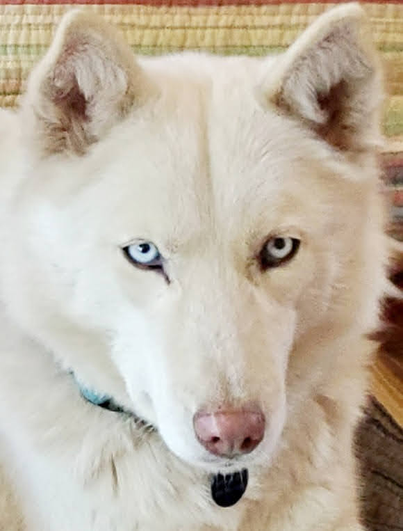
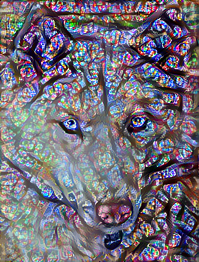
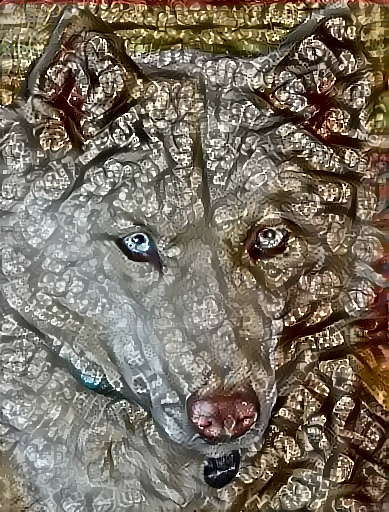

# Neural Style Transfer with TensorFlow

A deep learning project that applies artistic styles to photographs using TensorFlow and a pretrained VGG19 convolutional neural network (CNN).

The application allows users to upload their own images, generate stylized results, and choose whether to retain the original photograph's colors or adopt the colors of the style image.

## Example Results

**Content image**

**Style reference**

**Generated image — Style colors**

**Generated image — Original content colors**

## Technologies Used

- Python
- TensorFlow / Keras
- VGG19 pretrained CNN
- NumPy
- Pillow
- scikit-image
- Matplotlib
- ipywidgets
- Google Colab and Google Drive

## How It Works

Neural style transfer combines the visual content of one image with the artistic characteristics of another.

The project uses a pretrained VGG19 network to extract image features and optimizes a generated image by minimizing three losses:

- **Content loss:** Preserves the recognizable structures of the original image.
- **Style loss:** Captures artistic patterns, textures, and visual characteristics.
- **Total variation loss:** Encourages spatial smoothness and reduces visual noise.

Gradient-based optimization iteratively updates the generated image.

## Key Features

- Interactive content and style image uploads
- Configurable color preservation
- Training progress visualization
- Checkpoint saving and restoration
- Ability to generate different color versions without retraining
- Automatic saving of generated images to Google Drive

## Running the Project

1. Open `neural_style_transfer.ipynb` in Google Colab.
2. Install the required dependencies using the notebook's setup cell.
3. Mount Google Drive when prompted.
4. Upload content and style images.
5. Select the desired workflow and color mode.
6. Run training or restore a previously saved checkpoint.
7. View and save the generated image.

**Note:** Training can be computationally intensive. A GPU-enabled Colab runtime is recommended.

## Future Improvements

- Simplify the restoration workflow.
- Add adjustable training parameters through interactive controls.
- Support batch processing of multiple image pairs.
- Develop a standalone web interface.

## Project Notebook

[View the Jupyter Notebook](neural_style_transfer.ipynb)
